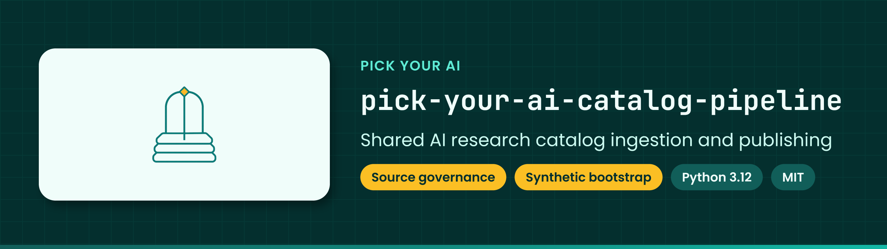

<!-- showcase:banner:start -->
<p align="center">
  
</p>
<!-- showcase:banner:end -->

<!-- showcase:nav:start -->
**Pick Your AI** · [All repositories](https://github.com/Pick-Your-AI) · [Docs](docs/) · [Contributing](CONTRIBUTING.md) · [Security](SECURITY.md)
<!-- showcase:nav:end -->

<div align="center">

# Pick Your AI — Catalog Pipeline

<!-- showcase:badges:start -->


[](https://github.com/Pick-Your-AI/pick-your-ai-catalog-pipeline/actions/workflows/validate.yml)
<!-- showcase:badges:end -->

<!-- showcase:tagline:start -->
**Shared AI research catalog ingestion and publishing: implementation backlog, evidence, source governance and synthetic bootstrap.**
<!-- showcase:tagline:end -->

</div>

---

## About

Shared ingestion, source governance, normalization, evidence review, catalog publication, freshness, and consumer delivery for the Pick Your AI research ecosystem.

**Bootstrap status — 2026-10-23 13:45:25 UTC:** the foundation, bounded issue-graph workflow and governance configuration inputs are published in the [public repository](https://github.com/Pick-Your-AI/pick-your-ai-catalog-pipeline), with successful hosted validation at the latest verified revision. All **81 canonical issues** are published and audited, with **81 native types, 80 internal parent links and 135 prerequisite links** verified. The external research #509 parent is verified separately.

**[Project #8](https://github.com/orgs/Pick-Your-AI/projects/8) is initialized and verified:** public metadata, native repository association, all **11 field definitions**, **81 members**, **891 item-field values**, and all **eight saved configurations and complete result memberships**. The separate 06:47:13 UTC ownership audit found all 81 issues open and unassigned. Private vulnerability reporting, Dependabot alerts/security updates, secret scanning, push protection and restricted Actions settings also have verified readbacks.

Repository metadata, **four existing team grants** and **all four active governance rules** are now verified. The default branch requires an independent approving review, approval of the latest push and the GitHub Actions `ci-required` check; its mandatory review rule has **no bypass actors**. The observed grants and rules include concurrent administrative changes and are preserved without attributing every change to the executor. The final eight-file status/configuration and bootstrap-metadata checkpoint still requires publication through a `contrib/` pull request, actual required approval, merge and exact-result readback. [BOOTSTRAP_STATUS.md](docs/BOOTSTRAP_STATUS.md) and [execution-receipt.json](planning/execution-receipt.json) retain the evidence. The mission remains incomplete until that final publication is verified. No production ingestion, catalog release or hosted service was deployed.

**Dated addendum — 2026-11-22:** The final eight-file status/configuration and bootstrap-metadata checkpoint was published through [PR #82](https://github.com/Pick-Your-AI/pick-your-ai-catalog-pipeline/pull/82), merged on 2026-11-19 as [`d2052182a6b827cefd7080ff2e6415926be9dbb8`](https://github.com/Pick-Your-AI/pick-your-ai-catalog-pipeline/commit/d2052182a6b827cefd7080ff2e6415926be9dbb8). This completes only that checkpoint publication gate. Canonical issue [#5](https://github.com/Pick-Your-AI/pick-your-ai-catalog-pipeline/issues/5) remains open; the broader bootstrap program, Project, rights, consumer-receiving, operational, and production criteria remain separate and unaccepted.

The public repository is `Pick-Your-AI/pick-your-ai-catalog-pipeline`, repository ID `1430404474`. The latest source revision verified for this snapshot is [`77f92e8ee6b4c35a7cacb3be6ef26462888188a7`](https://github.com/Pick-Your-AI/pick-your-ai-catalog-pipeline/commit/77f92e8ee6b4c35a7cacb3be6ef26462888188a7), with [successful hosted validation](https://github.com/Pick-Your-AI/pick-your-ai-catalog-pipeline/actions/runs/39925283272). That run's test step passed; the earlier log-verified **100-test** result remains attached to revision `b00b37d14ce4b4fa208770bf6d0a1396bd092053`. The dedicated Project is [**Pick Your AI — Catalog Pipeline, #8**](https://github.com/orgs/Pick-Your-AI/projects/8); its actual number was observed after creation. The implementation program is [catalog pipeline #1](https://github.com/Pick-Your-AI/pick-your-ai-catalog-pipeline/issues/1). The canonical parent research finding remains [research #509, G04](https://github.com/Pick-Your-AI/pick-your-ai-research/issues/509), verified as the native parent of the implementation program; research #509 and its existing Papers child remain open.


## Notes

### Purpose

Turn permitted, attributable research inputs into versioned, reviewable records and reproducible consumer releases. The platform must support the entire AI research ecosystem: models and providers, hosted offerings, hardware and runtimes, datasets and evaluations, applications and services, agents and integrations, papers and methods, organizations, use cases, trust attributes, and conditioned cost evidence.

The system preserves the distinction between an observation, a normalized claim, a reviewed finding, a source-use decision, an eligible publication, and a consumer's accepted delivery. Unknowns remain explicit. A valid schema or a merged research proposal does not by itself establish truth, legal permission, freshness, or production readiness.

### Boundaries

| Responsibility | Canonical location |
| --- | --- |
| Research methods, accepted evidence/source policy, T0–T6 decisions, frozen builder v1 contracts | [pick-your-ai-research](https://github.com/Pick-Your-AI/pick-your-ai-research) |
| Shared acquisition, normalization, provenance, review gates, immutable releases, correction and delivery machinery | This repository |
| Public browsing, reference pages, search/filter UI, editorial presentation, accessibility and SEO | [pick-your-ai-website](https://github.com/Pick-Your-AI/pick-your-ai-website) |
| Native Apple and Android experiences and client receiving tests | [pick-your-ai-apple](https://github.com/Pick-Your-AI/pick-your-ai-apple), [pick-your-ai-android](https://github.com/Pick-Your-AI/pick-your-ai-android) |
| Contributor recognition | [pick-your-ai-leaderboard](https://github.com/Pick-Your-AI/pick-your-ai-leaderboard) |
| Funding and nonprofit sustainability research | [pick-your-ai-sustainability](https://github.com/Pick-Your-AI/pick-your-ai-sustainability) |

The new catalog contract is a separately versioned draft. It must not modify the research repository's frozen `contracts/v1/` bytes or silently extend its 29 builder kinds. Builder compatibility is delivered through reviewed projections and versioned handoffs. Source-specific research and broader domain repositories remain authoritative for their own findings.

The existing [shared service baseline](https://github.com/Pick-Your-AI/pick-your-ai-android/blob/main/docs/SERVICE_BASELINE.md) places the future builder API in the website's `services/planner-api` lane. This pipeline supplies qualified immutable artifacts to that service. It does not create a second user-build, evaluation, authentication or cost-estimation backend.

### Read the plan

- [Charter](docs/charter.md): purpose, scope, success measures, and exclusions.
- [Architecture](docs/ARCHITECTURE.md): proposed boundaries, data flow, failure handling, and contract design.
- [Delivery plan](docs/DELIVERY_PLAN.md): implementation hierarchy and sequencing.
- [Dependencies](docs/DEPENDENCIES.md): actual prerequisites versus informational handoffs.
- [Research handoffs](docs/RESEARCH_HANDOFFS.md): accepted inputs and required receiving evidence.
- [Governance](docs/GOVERNANCE.md): ownership, review, decisions, and completion rules.
- [Operations](docs/OPERATIONS.md): planned operational controls and release gates.
- [Project setup](docs/PROJECT_SETUP.md): intended Project configuration and verified execution state.

The machine-readable planning sources are [`planning/project-backlog.json`](planning/project-backlog.json), [`planning/decision-register.json`](planning/decision-register.json), [`planning/release-manifest.json`](planning/release-manifest.json), and [`planning/coverage-matrix.json`](planning/coverage-matrix.json). Generated documentation is a projection of those sources. Live GitHub issue state, native relationships, Assignees, and Project field values require independent readback.

### Validate the bootstrap

Use Python 3.12 from the repository root:

```bash
python -m pip install -r requirements-validation.txt
python scripts/validate_plan.py
python scripts/validate_examples.py
python scripts/render_docs.py --check
python -m unittest discover -s tests -v
```

To regenerate planning documentation after an intentional plan change:

```bash
python scripts/render_docs.py
```

These commands check local structure and consistency. They do not fetch source terms, verify empirical claims, approve rights, create GitHub resources, or establish consumer acceptance. Report actual results and any unexecuted checks; do not infer success from the presence of these commands.

### Data and publication

All initial files under [`examples/`](examples/) are explicitly **synthetic** and are unsuitable for real catalog publication. The initial release manifest must preserve that boundary. No current research proposal is automatically imported as cleared product data.

The research [publication eligibility handoff](https://github.com/Pick-Your-AI/pick-your-ai-research/blob/main/docs/PUBLICATION_ELIGIBILITY_HANDOFF.md) establishes no blanket permission for complete existing catalog or pricebook artifacts. Retrieval, internal use, commercial display, and redistribution require separate source/material/use decisions. Mixed-source records cannot inherit their most permissive source's rights.

### Contribute

Read [CONTRIBUTING.md](CONTRIBUTING.md), [AGENTS.md](AGENTS.md), and the [organization contribution policy](https://github.com/Pick-Your-AI/.github/blob/main/CONTRIBUTING.md). Use native GitHub Assignees for actual ownership. The initial plan leaves work unassigned until a responsible maintainer accepts it; a historical research owner list does not assign new implementation work.

Original code and documentation use the [MIT License](LICENSE), following the research repository. Third-party materials and derived datasets retain their own rights and notices. Report security-sensitive problems through the process in [SECURITY.md](SECURITY.md).

### Contributor routing

For a blocked decision, use [the repository routing procedure](CONTRIBUTING.md#routing-decisions).
Start with the existing issue and its accepted owner; preserve its scope and evidence requirements.
