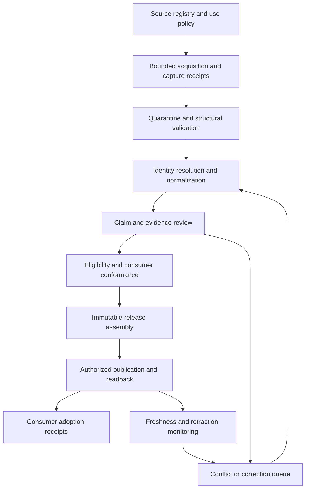

# Catalog pipeline architecture

## Status and purpose

This document specifies the implementation target. The repository bootstrap contains a planning baseline, draft schemas, synthetic examples and validation tools; it does not establish a running ingestion platform, approved source access, a deployed API or production publication.

The catalog pipeline turns eligible Pick Your AI research into reproducible, versioned artifacts for approved consumers. Its scope is the entire research ecosystem: models and modalities; datasets and evaluations; hardware and infrastructure; software, frameworks, agents and integrations; security, privacy and governance; costs and procurement; market evidence; sustainability and support opportunities; and future domains admitted through a reviewed registry. Domain coverage does not assert that every domain already has a production contract or publication permission.

Research findings and shared builder contracts remain owned by [pick-your-ai-research](https://github.com/Pick-Your-AI/pick-your-ai-research). The pipeline owns ingestion execution, normalization, provenance processing, eligibility enforcement, artifact assembly and publication receipts. Consumer repositories own their application behavior and acceptance.

## Boundaries with existing services

The [accepted shared-service baseline](https://github.com/Pick-Your-AI/pick-your-ai-android/blob/main/docs/SERVICE_BASELINE.md) selects a future separately deployed TypeScript/Node API and managed PostgreSQL on Render, with the canonical server package in the existing website's `services/planner-api` lane. The recorded historical `Pick-Your-AI/pickyour.ai` coordinate now resolves through the renamed [pick-your-ai-website](https://github.com/Pick-Your-AI/pick-your-ai-website) repository. Catalog Pipeline supplies qualified, immutable artifacts to that service's publication/read module; it does not create competing user-build storage, authentication, compatibility evaluation, cost estimation or client backends.

The service decision names an intended deployment and unfilled operating acceptance gates. It does not supply an existing host, credentials, a database, an operator or authorization to incur charges. Pipeline workers have their own deployment and source credentials. An approved deployment decision must establish where workers, staging state and permitted artifacts run and how the canonical service receives them.

The [website data-integration contract](https://github.com/Pick-Your-AI/pick-your-ai-website/blob/main/docs/DATA_INTEGRATION.md) remains the current application seam. Frozen `ai-builder-contract-v1` version `1.0.0` is preserved byte for byte. Its global `bearerAuth` requirement also covers GET operations. Anonymous distribution must use a separately authorized public artifact channel or an accepted contract revision; an anonymous static mirror must not claim to implement the authenticated API unchanged. Static files can supply approved immutable reads, not dynamic build writes, evaluation or estimation.

## Processing flow

Each transition records its inputs, exact producer revision, policy version, outcome and limitations. A rejected or interrupted attempt retains its history. Reprocessing creates a new attempt and never rewrites an accepted historical artifact to disguise a prior failure.

### 1. Source registration and acquisition

The source registry identifies a provider, source location, API or file interface, permitted actions, source-policy revision, credentials boundary, supported domains and operational limits. The rights record is per source, artifact and intended use. Retrieval, caching, transformation, public display, API redistribution, export and training are distinct actions; a grant for one is not a grant for all.

Connectors fetch only a bounded, approved scope. They apply per-source concurrency, request budgets, explicit timeouts, pagination limits and retry policies. Conditional requests, stable cursors and provider revisions reduce unnecessary traffic where supported. Checkpoints are committed after durable processing, not after sending a request. Exhausted permissions or rate limits become visible run outcomes.

Every attempt produces a capture receipt with retrieval time, publisher timestamp when available, source revision or response validator, content digest, connector revision, policy reference and result. Raw content is retained only when its rights and privacy policy permit retention. Otherwise the receipt retains the allowed metadata or evidence reference. Public reachability and a successful HTTP response establish neither truth nor reuse rights.

### 2. Quarantine and normalization

Raw input is untrusted data. Parsing runs with bounded bytes, depth, decompression, item counts and time. Remote schema resolution, arbitrary redirects, executable imports and instructions embedded in a source are refused unless an explicit supported adapter admits the specific operation. A research page cannot change worker tools, credentials, rules or publication decisions.

Normalization separates an entity from a claim about it. A stable entity may have several names, versions, deployments or offers. A claim records its subject, predicate, value, units, applicable version, region, configuration, validity interval and evidence. Missing information is represented as unknown or absent according to the applicable schema; it is not converted into false, zero, an empty list or unsupported capability.

Identity decisions retain source identifiers, aliases, merge/split history and attribution. Similar names do not automatically identify the same model, product, organization, dataset or service. Deduplication must distinguish repeated capture of the same claim from genuinely independent corroboration. Financial quantities preserve exact decimal strings and source currency; no automatic exchange-rate or region/account fallback is introduced.

### 3. Evidence, rights and review

Research acceptance, claim confidence, source rights, technical validity and publication eligibility are separate states. A merged research PR can be accepted research while its catalog artifact remains incomplete or ineligible for publication. A vendor claim can be faithfully represented without being independently verified.

The evidence workflow preserves the original claim and provenance grade. A source-check flag requires inspection of the actual claim. New independent-verification claims require an accepted independent-support or reproducible-test receipt. A historical `verified` label alone is insufficient. Conflicts retain both sources, their scopes and the resolution rationale; unresolved conflicts must not silently choose a convenient value.

The pipeline consumes the canonical [publication eligibility handoff](https://github.com/Pick-Your-AI/pick-your-ai-research/blob/main/docs/PUBLICATION_ELIGIBILITY_HANDOFF.md) and [source-use rights work](https://github.com/Pick-Your-AI/pick-your-ai-research/issues/60). A missing rights row does not permit automated acquisition, caching, display or redistribution. The inspected handoff explicitly excludes GPUs.io API retrieval, display and export from current product intake. Such exclusions remain effective until the owning authority records a specific change.

### 4. Artifact assembly and publication

A release is assembled from exact approved record revisions, evidence dispositions and rights decisions. It records the normalizer and schema versions, relevant policy versions, record count, deterministic digests, intended consumers, limitations and accepted review references. An identical source set and transformation version must produce identical artifact bytes or an explained, bounded nondeterministic field outside the content digest.

Publication is permitted only when all applicable checks pass:

1. The source and intended use are authorized under the recorded rights decision.
2. Required research and claim review has accepted the exact inputs and limitations.
3. Structural and semantic validation passes without invented values or unresolved required references.
4. Consumer projections satisfy the selected version's contract and required conformance cases.
5. The release and destination are authorized, and synthetic or quarantined records are excluded from real channels.
6. The deployed bytes, digests and access policy are independently read back after publication.

A publication transaction promotes an immutable candidate with a compare-and-swap channel update and an idempotency receipt. Partial upload, competing promotion or failed readback leaves the previous accepted release active. A mutable channel pointer, if later accepted, is a separate versioned interface; frozen v1 currently has no current-catalog endpoint. A release manifest must not quietly invent one.

Rollback changes the active channel to a retained approved release and records the reason. Retraction marks an affected artifact or claim as withdrawn and signals consumers; it does not delete historical identity or rewrite saved builds. Emergency access withdrawal and permitted deletion of restricted source material follow an explicit incident procedure while retaining the allowed audit metadata.

## Data model and contract layers

| Layer | Responsibility | Version and ownership boundary |
|---|---|---|
| Source registry and use policy | Provider identity, connector scope, per-action rights, limits and review dates | Pipeline operating records consuming canonical source-rights authority |
| Capture and ingestion run | Exact attempted input, timing, revision, digest, checkpoint and failure evidence | Immutable attempt identity; limited retention according to policy |
| General-domain record | Stable identity, typed domain payload, version, relationships and provenance | Pipeline-owned draft schema namespace; reviewed domain registry; no implicit builder-kind expansion |
| Claim and evidence graph | Scoped assertions, citations, contradictory observations and review receipts | Research semantics retained; source checking and independent support separate |
| Publication decision | Eligibility for a named release, consumer and use | Exact rights/evidence/policy revisions; revocable future eligibility without rewriting history |
| Release manifest and artifact | Deterministic approved projection, digests, provenance and activation | Immutable version and independently verified bytes |
| Consumer adoption receipt | Received producer revision, supported contract, conformance and acceptance limits | Owned by the receiving website, mobile client, service or future consumer |
| Correction and operating receipt | Freshness findings, incident, retry, replay, withdrawal and restore outcomes | Attributable append-only history with policy-controlled private details |

The initial schema files are a bootstrap draft. Their successful validation establishes structural consistency only. They do not supersede research contracts or release an accepted organization-wide interoperability standard.

The frozen builder contract is a consumer projection with 29 existing kinds. Broader domains use their own reviewed payload schemas and adapters. A funding opportunity, governance rule, benchmark record or educational resource must not be forced into a model-shaped record. A new domain admission specifies its authority, identity rules, claim semantics, rights requirements, consumer use, tests and migration policy.

Contract changes use an explicitly versioned successor, reviewed migration and receiving decisions. Original frozen bytes, checksums, examples and expectations remain available. The [Android revision handoff](https://github.com/Pick-Your-AI/pick-your-ai-android/blob/main/docs/CONTRACT_REVISION_HANDOFF.md) supplies a concrete cross-consumer procedure. English display labels are an independently accepted sidecar and retain their separate version and digest; they are not a reason to alter frozen kind identifiers.

## Implementation design

Use a modular worker application with clear source-adapter, normalization, review, artifact-builder and publisher interfaces. TypeScript/Node is the proposed production worker language to align with the selected canonical service. Repository planning utilities remain Python and do not imply a Python production runtime. Exact runtime, dependency and image versions are pinned when the implementation baseline is qualified.

Use transactional PostgreSQL state for ingestion attempts, checkpoints, identity mappings, review decisions and a durable work outbox when the runtime is implemented. Queue claims use expiring leases, bounded retries and idempotent handlers. This provides a small initial operating surface; separate message infrastructure is introduced only for an evidenced need. Pipeline staging and the canonical application service retain separate least-privilege identities and controlled data-transfer interfaces even if a future approved infrastructure decision places them with the same provider.

Immutable artifacts use a storage abstraction with content digests, explicit retention and atomic promotion semantics. Hosting, object storage, signing and credential mechanisms require a concrete deployment decision and tested recovery. The bootstrap provisions none of them. Large source dumps, model weights, private data and credentials do not belong in the public Git repository.

All mutation paths are idempotent within a declared scope. Work identities include source, source revision, connector/normalizer version and intended output. Replays can rebuild a candidate without recapturing an unchanged eligible source. Manual overrides require an attributable reason, bounded scope and review; they cannot silently bypass rights or manufacture evidence.

## Freshness, corrections and operations

Freshness policy distinguishes a source retrieval schedule, a statement's temporal applicability, a price's explicit validity and a selected artifact's identity. A capture interval is an operating parameter, not automatic expiration of every fact. Version-pinned facts remain pinned; current-state facts retain capture dates; a newer snapshot alone does not invalidate a saved build. The current research adopts no universal TTL.

Source outages, connector errors, revoked rights, stale observations, corrected claims and retracted artifacts produce different outcomes. Monitoring tracks the affected source/domain, last successful capture, review backlog, publication progress, rejected records and consumer lag. Unknown observations remain unknown. Dashboards must not report missing sources as zero records of available products or as completed ingestion.

Operators need tested pause/resume, replay, dead-letter inspection, credential rotation, correction, release rollback, backup restore and source-removal procedures. Proposed service targets become commitments only after an accepted owner and measurement method exist. Cost budgets, quota exhaustion and data growth are operational limits to qualify, not invented estimates in the bootstrap.

## Security and privacy

Separate read-only source credentials from publication credentials and administrative actions. Use least privilege, bounded egress, secret redaction, audit records and explicit deployment environments. Network adapters prevent private-address and metadata-service access, unsafe redirect chains and unbounded responses. Rendering treats imported Markdown, URLs and text as untrusted content. Exports address formula injection and confidential-field suppression where the format applies.

Research acquisition does not execute retrieved code, install arbitrary packages or run benchmarks. Those activities require separately qualified evaluation infrastructure. Private donor details, applications, credentials, internal discussions, customer material and restricted evidence never enter public artifact channels. Source attribution and licensing metadata are preserved without treating the repository's software license as a license to collected material.

## Verification and release stages

The delivery plan separates bootstrap, synthetic implementation, authorized source shadowing, qualified publication, consumer adoption and production operations. Every stage names its exit evidence. A planning CI pass is not a live-source, consumer or production acceptance result.

Future implementation tests must cover malformed and oversized input; unsupported versions; rights refusal and revocation; independent-evidence requirements; identity collisions; units and exact decimals; conflicting claims; interrupted pagination; repeated and out-of-order events; replay; concurrent publication; partial failure; retractions; consumer version rejection; and restore from retained artifacts. Cross-language contract tests exercise the actual website, Apple and Android boundaries where their receiving scope applies.

The bootstrap's own checks validate the hierarchy, identifiers, field vocabulary, coverage, dependency graph, synthetic labeling and generated-document consistency. Verification reports state the exact revision, commands, results and limits. Open implementation work remains open until its own acceptance evidence is reviewed.

## Canonical references

- [Parent research issue #509](https://github.com/Pick-Your-AI/pick-your-ai-research/issues/509)
- [Research workflow](https://github.com/Pick-Your-AI/pick-your-ai-research/blob/main/docs/RESEARCH_WORKFLOW.md)
- [Publication eligibility handoff](https://github.com/Pick-Your-AI/pick-your-ai-research/blob/main/docs/PUBLICATION_ELIGIBILITY_HANDOFF.md)
- [Website data integration](https://github.com/Pick-Your-AI/pick-your-ai-website/blob/main/docs/DATA_INTEGRATION.md)
- [Android shared-service baseline](https://github.com/Pick-Your-AI/pick-your-ai-android/blob/main/docs/SERVICE_BASELINE.md)
- [Android contract adoption](https://github.com/Pick-Your-AI/pick-your-ai-android/blob/main/docs/CONTRACT_ADOPTION.md)
- [Android contract revision handoff](https://github.com/Pick-Your-AI/pick-your-ai-android/blob/main/docs/CONTRACT_REVISION_HANDOFF.md)
- [Apple repository scope](https://github.com/Pick-Your-AI/pick-your-ai-apple/blob/main/docs/REPOSITORY_SCOPE.md)
- [Apple scoped research inputs](https://github.com/Pick-Your-AI/pick-your-ai-apple/blob/main/docs/decisions/research-inputs-20261018.md)
- [Sustainability program charter](https://github.com/Pick-Your-AI/pick-your-ai-sustainability/blob/main/docs/charter.md)
